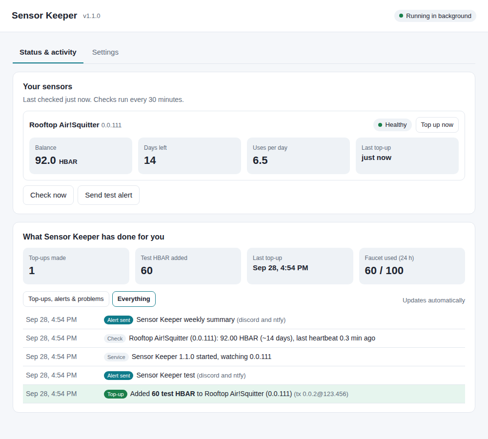

# Sensor Keeper

**Keeps your 4DSKY / Neuron sensor online by topping up its Hedera testnet HBAR automatically.**

Every 4DSKY sensor (Jetvision Air!Squitter and others) sends a heartbeat to the Hedera
testnet about every 40 seconds. Each heartbeat costs a tiny fee in *test* HBAR — roughly
6–7 HBAR a day. When the sensor's account runs dry, the heartbeats stop, the sensor shows
as offline, and it stops earning points.

Sensor Keeper runs quietly on any always-on computer (Mac, Windows, Linux, Raspberry Pi) and:

- checks each sensor's balance and heartbeats every 30 minutes (Hedera's public mirror node, read-only),
- tops the sensor up through **Hedera's official Faucet API** when it runs low,
- optionally checks a Jetvision Air!Squitter's status page on your network,
- checks that each sensor is **listed as available to buyers** in Neuron's on-chain seller registry (read-only),
- alerts you (Discord or phone push) **only** when something needs attention,
- sends an optional weekly "all good" summary,
- can **keep itself up to date** and **install Air!Squitter software updates** for you (both optional, off by default).

No Claude, no AI, no accounts with us. Nothing costs money — testnet HBAR is free and has no value.

> Unofficial community tool. Not affiliated with or endorsed by 4DSKY, Neuron or Hedera.

---

## Before you install: get a Hedera Portal access token (2 minutes)

Top-ups come from Hedera's free faucet, which needs a token tied to your own free Hedera
Portal account.

1. Go to **https://portal.hedera.com** and sign in (or create a free account).
2. Open your account settings and create a **Personal Access Token**.
3. Keep it handy — setup will ask for it. It's stored only on your computer.

You'll also need your **sensor's own Hedera device account ID** (looks like `0.0.1234567`) — the
account that pays for the sensor's heartbeats, not your wallet or rewards account. It's shown in
the 4DSKY app and in your sensor's Neuron setup; on hashscan.io it's the account with a steady
stream of "consensus submit message" transactions.

**Jetvision Air!Squitter owners:** also have your sensor's **IP address** on your network ready, and make
sure it's **fixed** (never changes). Every network is different, so use *your* sensor's address — find it in
your router's list of connected devices (often named `air-squitter`), or try `air-squitter.local`. To fix it,
set a **DHCP reservation** ("fixed IP" / "static lease") for the air-squitter in your router, or set a static IP
on the sensor (Settings → Network) if you know your network's netmask, gateway and DNS. Sensor Keeper uses
this address for health checks, diagnosis, updates and fixes; if it changes, Sensor Keeper loses track of the
sensor until you update it. Without it, top-ups and heartbeat alerts still work.

## Install

### Easiest: double-click

- **Mac:** download `Sensor-Keeper-Mac-installer.zip` from the
  [latest release](../../releases/latest), unzip, and double-click
  **Install Sensor Keeper (Mac).command**.
  If macOS says it can't be opened, right-click the file → **Open** → **Open**.
- **Windows:** download `Sensor-Keeper-Windows-installer.zip`, unzip, and double-click
  **Install Sensor Keeper (Windows).bat**. If SmartScreen appears, click **More info → Run anyway**.

### Terminal (one line)

macOS / Linux / Raspberry Pi:

```bash
curl -fsSL https://raw.githubusercontent.com/killgja/sensor-keeper/main/install.sh | bash
```

Windows (PowerShell):

```powershell
irm https://raw.githubusercontent.com/killgja/sensor-keeper/main/install.ps1 | iex
```

Either way, the **Sensor Keeper app** opens in your web browser (it runs only on your own
computer). Fill in the Settings tab and press **Save**:

1. your sensor account ID(s) — press **Check** to confirm each one on Hedera,
2. your Hedera Portal access token,
3. when to top up (default: below 40 HBAR, 60 HBAR at a time),
4. where to send alerts (optional),
5. then press **Start background service**.

On a computer without a screen (e.g. a headless Raspberry Pi) the installer asks the same
questions in the terminal instead.



## Every setup is different

Sensor Keeper doesn't assume anything about your network or hardware:

- **Your sensor's IP address** is whatever *your* router gave it. Setup asks for it, tests it, and explains how
  to make it **fixed** (DHCP reservation in your router, or a static IP on the sensor). Hostnames such as
  `air-squitter.local` also work where your computer supports them (an IP address is most reliable on Windows).
- **Sensors at several locations:** Hedera checks and top-ups work for every sensor from anywhere. Health
  checks, diagnosis, updates and fixes need to reach the sensor, so they only work from a computer on the
  **same network** as that sensor. Leave the IP blank for sensors elsewhere, or run Sensor Keeper on a computer
  at each location (each one watching its local sensors).
- **More than one Sensor Keeper with the same Hedera token:** fine, but the faucet's 100 HBAR/day limit is per
  token, so the computers share it. If one hits the limit, the others wait and retry automatically.
- **Not an Air!Squitter?** Any 4DSKY/Neuron sensor gets balance top-ups and heartbeat alerts. The deeper checks,
  updates and fixes are for Jetvision Air!Squitters.
- **MLAT turned off or not registered:** Sensor Keeper doesn't treat that as a fault. It falls back to the
  heartbeats (and, for fixes, a small probe that checks DNS on the sensor itself).
- **Changed the sensor's admin password?** Enter it in Settings; otherwise the factory default is used.
- **Any always-on computer:** Mac, Windows, Linux or Raspberry Pi.

## Everyday use

Open **Sensor Keeper** from your Applications folder (Mac), Start menu or desktop icon (Windows),
or app menu (Linux) — or run `sensor-keeper ui`. The app shows:

- **Status & activity** — each sensor's balance, days of HBAR left, daily use and health, plus a
  running log of everything Sensor Keeper has done: top-ups (with Hedera transaction IDs), alerts
  sent and problems found. "Top up now", "Check now" and "Send test alert" buttons are here too.
- **Settings** — change any detail and press Save; the background service picks it up within a
  minute. Start or stop the background service here.

The app window is only reachable from your own computer and closes itself a minute or two after
you close the browser tab. The background service keeps running either way.

Terminal commands, if you prefer:

```text
sensor-keeper ui            open the app window
sensor-keeper status        balances, days left, last top-up, any problems
sensor-keeper check         run a check right now
sensor-keeper topup 0.0.x   request a top-up now
sensor-keeper setup         change settings in the terminal
sensor-keeper logs          last 40 log lines
sensor-keeper test-alert    make sure alerts reach you
sensor-keeper update        install the latest Sensor Keeper now
sensor-keeper update-sensors  check for and install Air!Squitter software now
sensor-keeper diagnose      explain what's wrong with a sensor and what to do
sensor-keeper fixes         list unofficial community fixes and whether you need them
sensor-keeper set-plug 0.0.x shelly|kasa <ip>   smart plug on the sensor's power ("off" removes it)
sensor-keeper power-cycle 0.0.x   switch the sensor off and on through its smart plug
sensor-keeper set-reserve 0.0.x   backup account to top up from if Hedera's faucet is blocked
sensor-keeper uninstall-service
```

Add `--dry-run` to `check`, `topup` or `run` to see what it would do without requesting HBAR.

## Fix it from your phone (Sky Warden app)

Pair Sensor Keeper with the Sky Warden iPhone app (`sensor-keeper remote-setup`, then `sensor-keeper remote-pair`, and scan the QR
code on your computer's screen). Each device page in the app then has a **Sensor Keeper at home**
section:

- **Diagnose** — Sensor Keeper checks the sensor from inside your home network and answers in
  seconds: does it answer, can it reach the internet, is the 4DSKY program sending heartbeats.
  The app runs this by itself when a device goes offline.
- **Restart the 4DSKY program**.
- **Power-cycle** — switches a frozen sensor off and on through a smart plug (below).

Messages go through the Sky Warden relay, end-to-end encrypted with the pairing secret (the relay
can't read them), or over the private Hedera topic when no relay is set. Only a fixed list of
commands is ever run; see [docs/remote-protocol.md](docs/remote-protocol.md).

## When Hedera's faucet is blocked

Hedera's portal sometimes puts a "Just a moment..." bot check in front of its faucet, which blocks
every automated top-up for a while. Sensor Keeper recognises this (it is **not** a problem with your
token), keeps retrying every few hours, and only alerts you if your sensor gets under two weeks of HBAR.

While the faucet is blocked, Sensor Keeper also asks the **shared Sky Warden reserve** for help when a
sensor drops under 50 HBAR. It sends 60 HBAR to real 4DSKY sensors (heartbeats in the last day), once a
day each, with no sign-up. Turn it off with `"sharedReserve": false` in the config.

You can also give Sensor Keeper a **reserve account** of your own: any testnet account
with spare HBAR. When the faucet is blocked, Sensor Keeper sends the top-up from it directly
over the Hedera network, which the portal's bot check doesn't affect.

```text
sensor-keeper set-reserve 0.0.x          asks for that account's private key
sensor-keeper set-reserve 0.0.x 500      also refill it to 500 HBAR with faucet allowance your sensors didn't need
sensor-keeper set-reserve off
```

The key stays in Sensor Keeper's config file on your computer (readable only by you) and is never
shown in the app. A reserve is never drained below 50 HBAR.

## Smart plug (optional): restart a frozen sensor

A sensor that froze or lost Wi-Fi for good only comes back when its power is switched off and on.
Put its power adapter on a smart plug and tell Sensor Keeper where it is:

```text
sensor-keeper set-plug 0.0.x shelly 192.168.1.60
sensor-keeper power-cycle 0.0.x        try it
```

- Supported: **Shelly** Gen2+ plugs (local RPC; the plug turns itself back on after 10 s) and
  **TP-Link Kasa** plugs with the older local protocol. Tapo plugs and newer Kasa firmware
  (KLAP login) aren't supported yet. Everything stays on your network; no cloud account.
- Give the plug a fixed IP address in your router.
- **Automatic:** when the sensor's status page fails two checks in a row, Sensor Keeper
  power-cycles it by itself (at most every 3 hours) and alerts you. Turn this off with
  `"autoPowerCycle": false` in the config.

## Automatic updates

Both are **off by default**. Turn either one on with its checkbox in Settings ("Keep Sensor Keeper
up to date automatically" / "Install Air!Squitter software updates automatically"), or answer "y"
in `sensor-keeper setup`. You can always update by hand with `sensor-keeper update` and
`sensor-keeper update-sensors`.

**Sensor Keeper itself.** Every 6 hours it checks this project's latest GitHub release. If there's
a newer version it downloads the build for your computer, checks it against the release's
`SHA256SUMS.txt`, swaps it in and restarts — then tells you on Discord/ntfy. Only the installed
copy in `~/.sensor-keeper/bin` updates itself.

**Your Air!Squitter's software.** For each sensor with a status page address, Sensor Keeper does
what you'd do on the sensor's *Settings → Software Maintenance → Software Update* page. It logs in
with jetvision's factory-default admin password; if you changed yours, enter it in Settings (or
`sensor-keeper setup`). Every 6 hours it logs in, and if jetvision is offering a newer
version it presses Update, waits for the sensor to restart, confirms the new version and tells you.
If an update doesn't finish within an hour it alerts you and retries a day later.

For urgent fixes jetvision doesn't offer automatically, a version can be pinned in
[`device-updates.json`](device-updates.json); every Sensor Keeper will then install it (forward only,
never a downgrade). Note: the sensor downloads updates from jetvision itself, so it needs working
internet access to update.

## Unofficial community fixes (opt-in)

Sometimes a sensor breaks in a way jetvision or 4DSKY haven't fixed yet. Sensor Keeper can carry
small **unofficial** fixes written by the community. They are **off unless you tick "Install
unofficial community fixes"** in Settings (or answer "y" in setup). When on, a fix is installed only
on a sensor that shows the exact problem it fixes, only once, through the sensor's own *Software
Maintenance → Upload and Install* page. You're told before and after, and if it doesn't help it is
not retried. Fixes are retired as soon as an official fix ships.

`sensor-keeper fixes` lists them and whether your sensors need them; `sensor-keeper apply-fix <id>`
installs one by hand.

| Fix | What it does |
| --- | --- |
| `jv-ksk2024-fix` — DNS fix for the October 2026 internet root-key change | On 11 Oct 2026 the DNS root key changed (KSK-2017 → KSK-2024). Air!Squitters only trusted the old key, so every name lookup failed ("Host not found"): MLAT and 4DSKY heartbeats stopped. Adds the new key (checked against IANA's list), adds a narrow exception for `voipgate.com` (its DNS security is broken upstream and the 4DSKY program needs `stun.voipgate.com` at startup), and restarts the 4DSKY program. DNS security stays on for everything else. Source: [`jetvision-dns-fix/`](jetvision-dns-fix). |
| `neuron-sdk-repair` — Restart or reinstall the 4DSKY program when heartbeats stop | If heartbeats have stopped for 30 minutes while the sensor's internet and DNS work, installs a tiny read-only probe (through the same Upload and Install page) that reports whether the 4DSKY program is installed and running, and **restarts it** if it has stopped. Only if the program is **missing** does it download 4DSKY's official package from Neuron's public GitHub, check it against the checksum pinned in [`device-updates.json`](device-updates.json), and install it. Existing 4DSKY settings are kept; if it asks for setup you're told to finish its wizard (it needs your private key — Sensor Keeper never stores private keys). At most two tries, a day apart. |
| `jv-voipgate-cleanup` — Remove the voipgate.com exception when it's no longer needed | Every 6 hours checks with Cloudflare's validating DNS whether `voipgate.com` passes again; once it does, installs jv-ksk2024-fix 1.2.0, which removes the exception so every lookup is checked again. Only on sensors where Sensor Keeper installed the DNS fix. |

### Problems Sensor Keeper explains but doesn't change for you

When a sensor stops sending heartbeats, Sensor Keeper works out why and alerts you once per cause with what
to do (also `sensor-keeper diagnose`): sensor unreachable on your network (power/cable/Wi-Fi), no internet,
DNS broken, 4DSKY program not sending heartbeats although the internet works, or 4DSKY program waiting for setup. Sensor Keeper never changes
the sensor's network settings itself: a wrong guess there could take the sensor off your network until someone
fixes it by hand.

> Never use the sensor's `:1336/reinstall-package` link to "fix" the 4DSKY program: it uninstalls first and,
> if the download then fails, leaves the program removed.

## Alerts

| Channel | How |
|---|---|
| Discord | Channel settings → Integrations → Webhooks → New webhook → copy URL |
| Phone push | Install the free **ntfy** app by Philipp Heckel ([iPhone](https://apps.apple.com/us/app/ntfy/id1625396347) · [Android](https://play.google.com/store/apps/details?id=io.heckel.ntfy)) — white bell on a teal icon. **Not** "Ntfy me" or "Ntfy me - Next Gen"; those are unrelated apps that won't receive these alerts. Tap **+**, subscribe to a hard-to-guess topic name on the default ntfy.sh server (anyone who knows the name can read your alerts), and give setup the same name. Then run `sensor-keeper test-alert`. |

### Phone push alerts with ntfy (step by step)

[ntfy](https://ntfy.sh) is a free notification relay: Sensor Keeper posts a short message to a
*topic* on ntfy.sh, and every phone subscribed to that topic gets it as a normal notification.
No account or sign-up is needed.

1. **Install the right app** — **ntfy** by Philipp Heckel (white bell on a teal icon):
   [iPhone / iPad](https://apps.apple.com/us/app/ntfy/id1625396347) ·
   [Android (Google Play)](https://play.google.com/store/apps/details?id=io.heckel.ntfy) ·
   [Android (F-Droid)](https://f-droid.org/packages/io.heckel.ntfy/).
   ⚠️ **Not** "Ntfy me" or "Ntfy me - Next Gen" — those are unrelated apps and won't receive these alerts.
2. **Pick a topic name.** It works like a password: anyone who knows it can read (or send to) your
   alerts, so make it unique and hard to guess, e.g. `sk-yourname-7q4m2x`. Letters, numbers, `-` and `_` only.
   Don't use a generic name like `4dsky` — other operators might pick the same one.
3. **Subscribe on your phone.** Open ntfy → tap **+** → enter your topic name exactly (it's case-sensitive) →
   leave "Use another server" **off** (the default `ntfy.sh`) → **Subscribe**.
4. **Allow notifications** when your phone asks (iPhone: Settings → Notifications → ntfy → Allow).
5. **Tell Sensor Keeper the topic.** In the app's Settings tab, type the same name in "Phone push — ntfy topic"
   and press Save (or in the terminal: `sensor-keeper setup`).
6. **Test it:** press **Send test alert** on the app's Status tab (or run `sensor-keeper test-alert`) — a
   "Sensor Keeper test" notification should arrive within seconds.

To change topics later, subscribe to the new name in the app, run `sensor-keeper setup` with the new
name, then remove the old subscription. Alerts go to every phone subscribed to the topic, so family
members can subscribe too.

You'll get an alert when a sensor stops sending heartbeats, a top-up fails, your token is
rejected, a sensor is nearly out of HBAR, the Air!Squitter status page shows a problem or goes
unreachable, or a sensor account disappears (testnet reset) — and a short "resolved" note when
it recovers. Repeat reminders are limited to every 12 hours.

## Hedera's limits (built in)

Hedera's Faucet API allows **100 test HBAR per person per rolling 24 hours** and **one funding
per destination account per 24 hours**. A sensor uses about 7 HBAR a day, so a single top-up
every week or so is plenty. With several sensors, the daily 100 is shared and top-ups are
spread out automatically. Sensor Keeper tracks this locally so it never asks for more than
allowed.

Hedera documents the Faucet API specifically for "scripts, CI/CD pipelines, SDKs, or agentic
workflows": https://docs.hedera.com/learn/getting-started/faucet-api

## Testnet resets

Hedera resets the testnet every few months, which deletes every testnet account — including
your sensor's. Sensor Keeper will alert you. To recover, create/claim a new device account in
the 4DSKY app, re-run your sensor's Neuron setup with it, then run `sensor-keeper setup` and
enter the new ID.

## Privacy & security

- Settings are stored in `~/.sensor-keeper/config.json` (Windows: `%USERPROFILE%\.sensor-keeper`),
  readable only by your user account.
- **No private keys** are ever requested or stored. The faucet sends HBAR straight to your sensor.
- The only places it talks to: Hedera's mirror node (including a read-only lookup in Neuron's seller registry contract), Hedera's faucet, your sensor's web page
  (if you add it), the alert services you choose, and — for automatic updates — GitHub (this
  project's releases and `device-updates.json`) and jetvision's public version-history page.
- The Air!Squitter admin password is only ever sent to your sensor on your own network. If you
  enter your own (instead of the factory default), it's stored only in `config.json`.
- It's one readable file: [`keeper.js`](keeper.js). No third-party packages.

## Uninstall

```bash
sensor-keeper uninstall-service
rm -rf ~/.sensor-keeper          # Windows: delete %USERPROFILE%\.sensor-keeper
```

## Build from source

Needs Node.js 18+ only: `node keeper.js setup`. Standalone programs are built with
[Bun](https://bun.sh) by the GitHub Actions workflow in `.github/workflows/release.yml`
whenever a `v*` tag is pushed.

## License

MIT — see [LICENSE](LICENSE).
